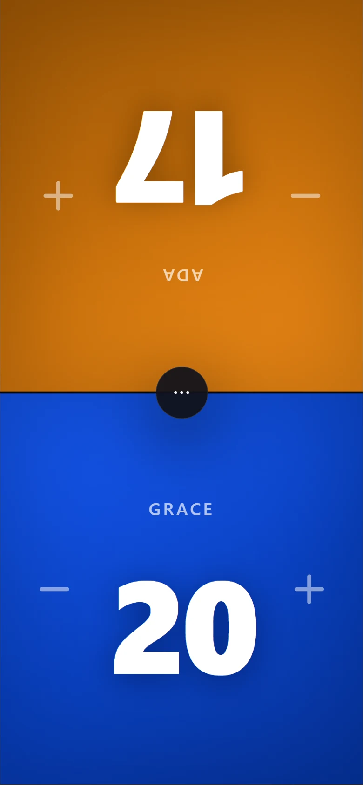
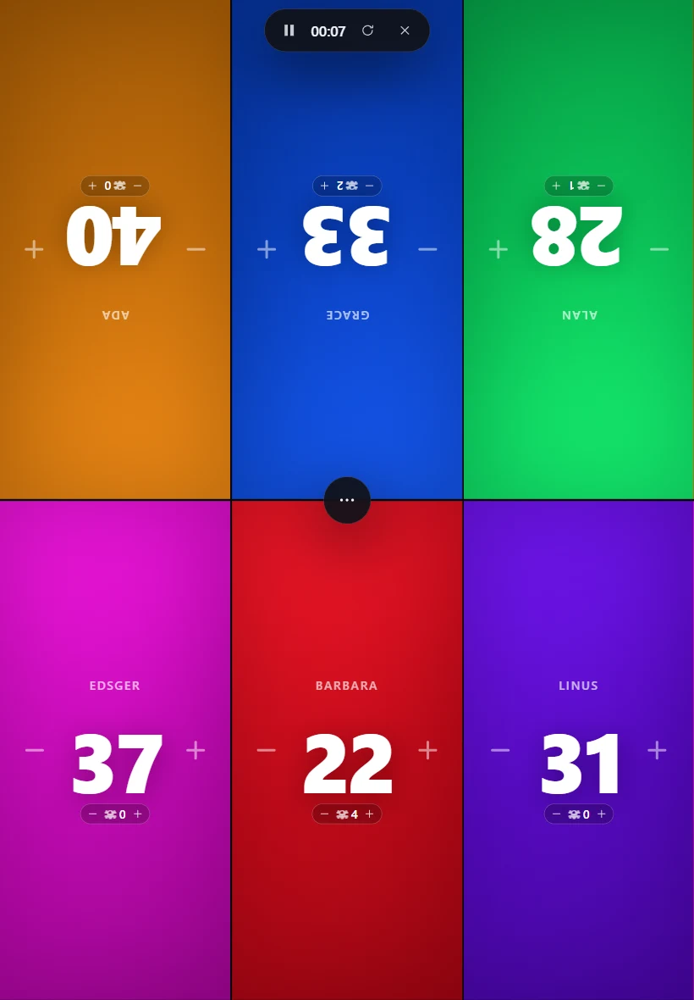
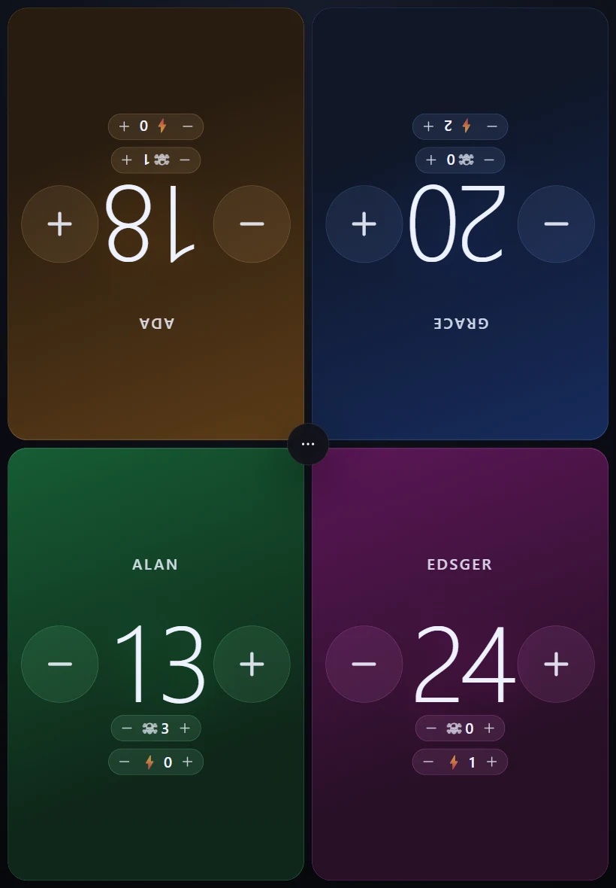
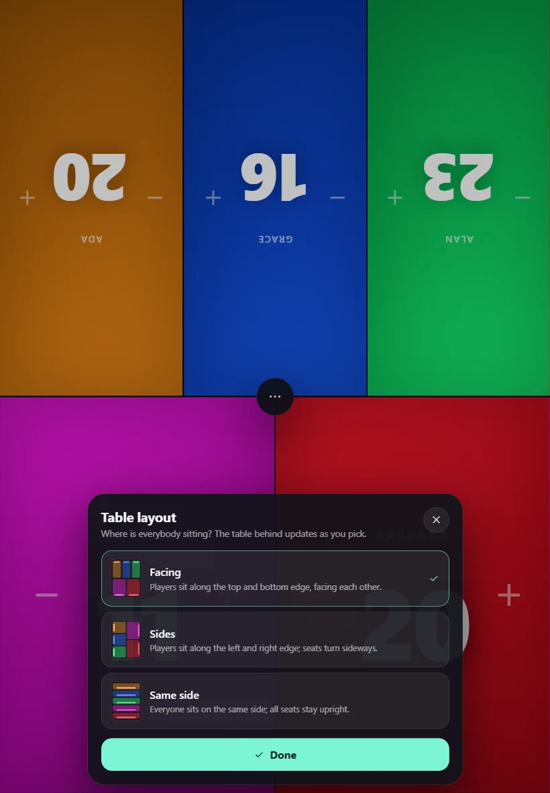
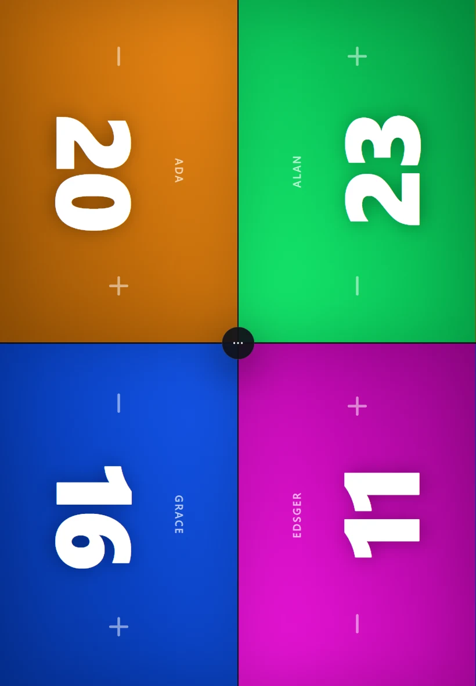
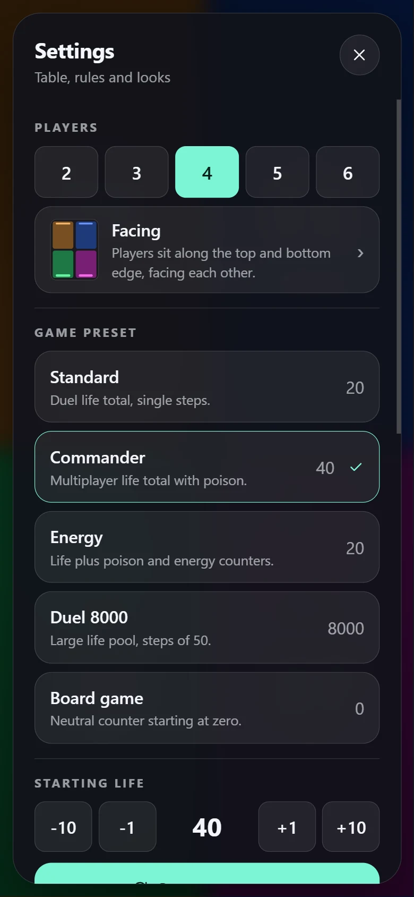
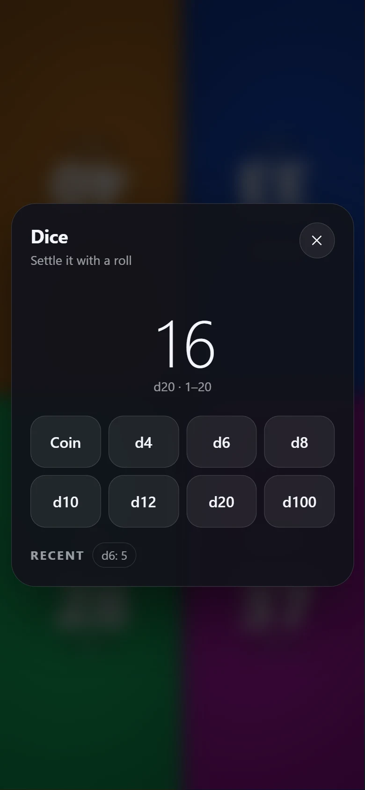
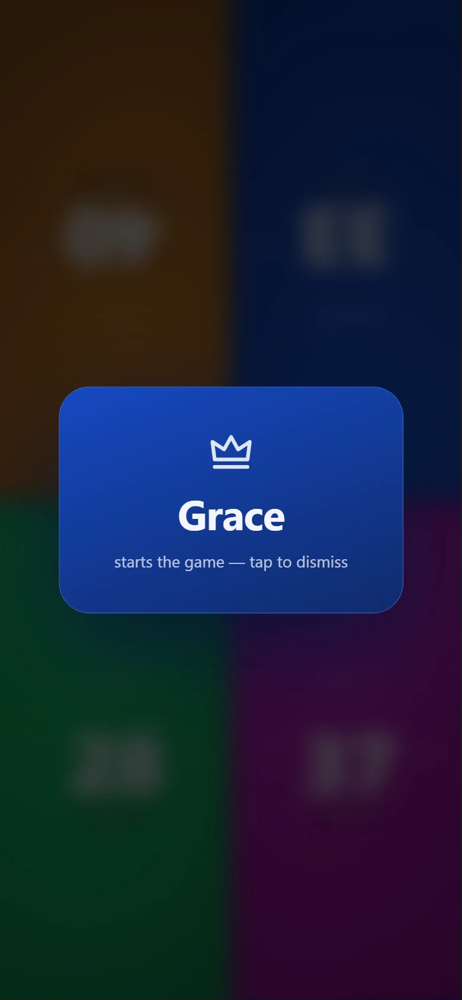

# GameLifeCounter

A life counter for board and card games that runs entirely in the browser.

[Open the app](https://albertlast.github.io/GameLifeCounter/)



## Features

- **2 to 6 players.** Picking the player count asks how the table is seated,
  and the table behind the chooser updates as you pick:
  - _Facing_ (default) puts players along the top and bottom edge facing each
    other, the way the two player table works. Life totals and the -/+ buttons
    read horizontally for everybody.
  - _Sides_ turns the same table a quarter turn for players sitting along the
    left and right edge.
  - _Head of table_ (3 or 5 players) is the hybrid an odd count falls into at a
    real table: one player at the head, the other two or four facing each other
    down the sides. Offered only where the remainder splits evenly between the
    two sides.
  - _Same side_ stacks every seat upright, for when nobody sits opposite.

  Each seat is rotated towards the edge its player sits at, so nobody reads
  their life total upside down.

- **Tap and hold.** A tap changes the life total by one step, holding a button
  keeps applying the big step until you let go. Recent changes are summed up
  and shown above the total ("-7") before fading away.
- **Game presets.** Standard (20), Commander (40 with poison), Energy (poison
  and energy counters), Duel 8000 (steps of 50) and a neutral board-game
  counter. The starting life total can be adjusted freely.
- **Two themes.** _Pulse_ keeps the original edge-to-edge colour blocks with
  oversized numerals; _Arena_ puts floating player cards on a dark stage.
- **Player identity.** Each seat has its own name and colour.
- **Table tools.** Dice (coin, d4–d100), a match timer and a random
  first-player picker, all reachable from the hub in the middle of the table.
- **Installable and offline.** The app is a PWA and keeps its state in local
  storage, including the life totals and colours of the previous version.
- **Screen options.** Fullscreen and, where the browser supports it, a wake
  lock that stops the screen from sleeping mid-game.

## Screenshots

<table>
  <tr>
    <td width="50%" valign="top">
      
      <sub><b>Six players, Commander preset.</b> Named seats, poison counters
      and the match timer running along the top.</sub>
    </td>
    <td width="50%" valign="top">
      
      <sub><b>Arena theme.</b> Floating player cards on a dark stage, here with
      poison and energy counters.</sub>
    </td>
  </tr>
  <tr>
    <td width="50%" valign="top">
      
      <sub><b>Layout chooser.</b> Opens right after the player count; each
      option is drawn for your table and the table behind updates as you pick.</sub>
    </td>
    <td width="50%" valign="top">
      
      <sub><b>Sides layout.</b> The same table turned a quarter turn for
      players sitting along the left and right edge.</sub>
    </td>
  </tr>
</table>

<table>
  <tr>
    <td width="33%" valign="top">
      
      <sub><b>Settings.</b> Players, preset, starting life, theme, names and
      colours.</sub>
    </td>
    <td width="33%" valign="top">
      
      <sub><b>Dice.</b> Coin and d4 to d100, with the recent rolls kept.</sub>
    </td>
    <td width="33%" valign="top">
      
      <sub><b>Random first player.</b> Announced in that player's colour; the
      crown stays on their seat.</sub>
    </td>
  </tr>
</table>

## Requirements

Only a webserver to deliver the static files; the app runs fully client side.

## Project setup

```sh
npm install
```

### Compile and hot-reload for development

```sh
npm run dev
```

### Type-check, compile and minify for production

```sh
npm run build
```

### Run the unit tests with [Vitest](https://vitest.dev/)

```sh
npm run test          # single run
npm run test:unit     # watch mode
npm run test:coverage # with coverage report
```

## Project structure

| Path                           | Contents                                                        |
| ------------------------------ | --------------------------------------------------------------- |
| `src/game/`                    | Game state, presets, seat layouts and persistence               |
| `src/theme/`                   | Theme catalogue and the binding to `<html data-theme>`          |
| `src/composables/`             | Hold-to-repeat, pending delta, dice, timer, fullscreen/wakelock |
| `src/components/`              | Vue components                                                  |
| `src/assets/styles/tokens.css` | Design tokens; a theme only overrides this block                |

Adding a theme means adding an entry to `src/theme/themes.ts` and a
`[data-theme='…']` token block — components read colours and sizes from
variables only.
